# TaskFlow

App de tareas del curso de Flutter. En esta sesión, `go_router` abre el detalle de una tarea y permite volver al listado. La guía del laboratorio sigue en [LEEME.md](LEEME.md). La procedencia de las capturas está en [EVIDENCIAS.md](EVIDENCIAS.md).

**Video de la ejecución (15,2 s):** [sesion-04-ejecucion.mp4](docs/evidencias/sesion-04-ejecucion.mp4). GitHub no lo reproduce dentro del README; el enlace abre el archivo para verlo o descargarlo.

## Entregas de las cuatro sesiones

Cada sesión se entrega con su propia rama de https://github.com/Mildreth-SC/taskflow. La rama muestra el código, el README, las evidencias y el video de esa sesión. Estas ramas se armaron el 7 de noviembre de 2026 a partir de las instantáneas ya publicadas. Los commits nuevos tienen la fecha de esta reconstrucción. Las capturas y los videos son los archivos reales de cada sesión.

| Sesión | Qué muestra la rama | Rama para entregar | Video |
| --- | --- | --- | --- |
| 1 | Pantalla de bienvenida | https://github.com/Mildreth-SC/taskflow/tree/sesion-01 | https://github.com/Mildreth-SC/taskflow/blob/sesion-01/docs/evidencias/sesion-01-ejecucion.mp4 |
| 2 | Panel con `setState`, meta de 5 y sin negativos | https://github.com/Mildreth-SC/taskflow/tree/sesion-02 | https://github.com/Mildreth-SC/taskflow/blob/sesion-02/docs/evidencias/sesion-02-ejecucion.mp4 |
| 3 | Listado con `TaskCard`, sin navegación | https://github.com/Mildreth-SC/taskflow/tree/sesion-03 | https://github.com/Mildreth-SC/taskflow/blob/sesion-03/docs/evidencias/sesion-03-ejecucion.mp4 |
| 4 | Detalle con `go_router` | https://github.com/Mildreth-SC/taskflow/tree/sesion-04 | https://github.com/Mildreth-SC/taskflow/blob/sesion-04/docs/evidencias/sesion-04-ejecucion.mp4 |

## Entrega de esta sesión

La sesión 4 se entrega con la rama `sesion-04`. Esa rama muestra el detalle con `go_router`, este README, las evidencias y el video.

- Repositorio: https://github.com/Mildreth-SC/taskflow
- Rama para entregar: https://github.com/Mildreth-SC/taskflow/tree/sesion-04
- Video de la ejecución: https://github.com/Mildreth-SC/taskflow/blob/sesion-04/docs/evidencias/sesion-04-ejecucion.mp4
- Video anterior de 9 s: https://github.com/Mildreth-SC/taskflow/blob/sesion-04/docs/evidencias/sesion-04-listado-detalle-regreso.mp4
- Listado: https://github.com/Mildreth-SC/taskflow/blob/sesion-04/docs/evidencias/sesion-04-listado.png
- Detalle: https://github.com/Mildreth-SC/taskflow/blob/sesion-04/docs/evidencias/sesion-04-detalle.png
- Regreso: https://github.com/Mildreth-SC/taskflow/blob/sesion-04/docs/evidencias/sesion-04-regreso.png

## Objetivo

Mostrar un listado de tareas de ejemplo y, al tocar una tarjeta, la ficha de esa tarea. La ruta del detalle lleva el id (`/task/:id`). Al volver, el listado sigue en pantalla.

## Qué hace la app

El código está en `lib/main.dart`.

- `GoRouter` define dos rutas: `/` (`TaskListScreen`) y `/task/:id` (`TaskDetailScreen`).
- El listado se titula **Mis tareas**. Cada tarjeta muestra el título, la prioridad, la descripción y un icono de estado (completada o pendiente).
- Al tocar una tarjeta, `context.push('/task/${id}')` abre el detalle. El detalle busca esa tarea en `demoTasks`.
- El detalle muestra el título, la descripción completa, un chip `Prioridad: …`, el texto `Estado: completada` o `Estado: pendiente`, y una acción contextual cuyo icono y frase cambian con el estado.
- **Volver al listado** llama a `context.pop()`. La barra de la pantalla de detalle también muestra la flecha atrás.
- Hay cinco tareas de ejemplo, con prioridades Alta, Media y Baja.
- El tema es Material 3, con color de semilla `#1F6F5B`.

## Requisitos

Declarados en `pubspec.yaml`:

| Paquete | Restricción |
| --- | --- |
| Dart | `sdk: ^3.13.7` |
| Flutter | SDK |
| `go_router` | `^18.1.3` |
| `cupertino_icons` | `^1.0.8` |
| `flutter_test` | SDK, dependencia de desarrollo |
| `flutter_lints` | `^6.0.0`, dependencia de desarrollo |

`pubspec.lock` deja resueltos `go_router` 18.1.3, `cupertino_icons` 1.0.9 y `flutter_lints` 6.0.0. El mismo archivo anota Dart `>=3.13.7 <4.0.0` y Flutter `>=3.47.0`. La app usa `publish_to: none` y la versión `1.0.0+1`.

## Ejecutar

```bash
flutter pub get
flutter run
```

## Comprobar

Los comandos que ya indica [LEEME.md](LEEME.md):

```bash
dart format lib
flutter analyze
flutter test
```

`flutter test` ejecuta la prueba que está en `test/widget_test.dart`: `cada tarjeta abre su detalle y se puede volver`. Esa prueba abre las tareas «Crear el proyecto TaskFlow», «Probar el panel de tareas» y «Preparar el detalle», y comprueba la ruta (`/task/1`, `/task/3`, `/task/5` y la vuelta a `/`), la prioridad, el estado, la acción contextual y el regreso al listado.

## Estructura

- `lib/main.dart` — interfaz, datos de ejemplo y rutas
- `test/widget_test.dart` — prueba de navegación
- `pubspec.yaml`, `pubspec.lock` — dependencias
- `LEEME.md` — guía de la sesión
- `EVIDENCIAS.md` — procedencia de las capturas
- `docs/evidencias/` — PNG y MP4 de esta sesión
- `android/` — aplicación `com.example.taskflow`
- `ios/`, `linux/`, `macos/`, `web/`, `windows/` — plataformas del proyecto Flutter

## Evidencias en el emulador

Capturas del emulador Android remoto AVD `taskflow_api35` (Android 15, API 35), tomadas con Flutter 3.47.9. El detalle está en [EVIDENCIAS.md](EVIDENCIAS.md). La entrega de esta sección es https://github.com/Mildreth-SC/taskflow/tree/sesion-04.

### Listado

Ruta `/`. Título **Mis tareas**. Las dos primeras tarjetas están completadas y las tres siguientes pendientes. Cada una muestra prioridad y descripción.


### Detalle

Detalle de **Probar el panel de tareas** (id 3, ruta `/task/3`): descripción, chip **Prioridad: Alta**, **Estado: pendiente**, acción contextual de tarea pendiente y el botón **Volver al listado**.

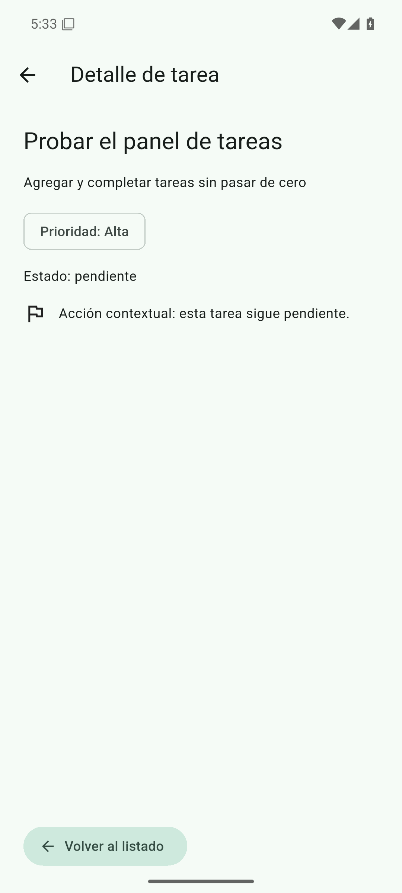

### Regreso

El listado **Mis tareas** otra vez, después de **Volver al listado**. Las cinco tarjetas siguen en pantalla.

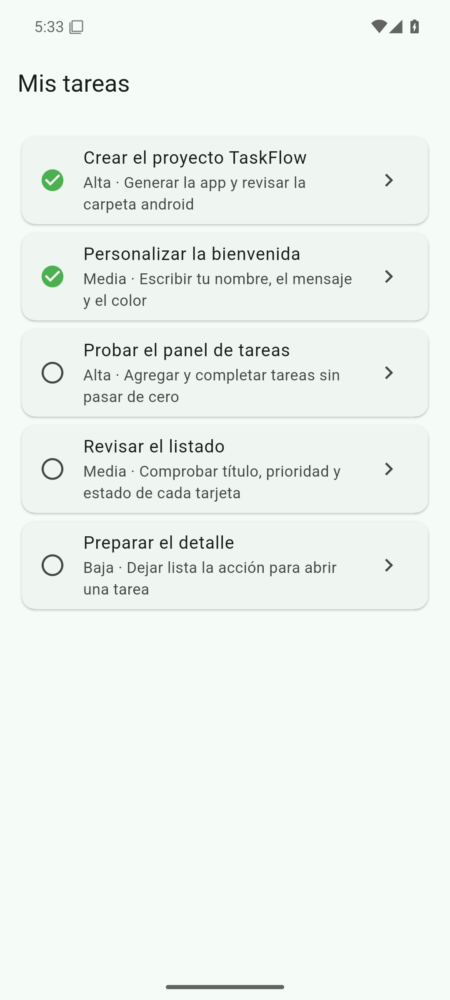

### Video de la ejecución

Enlace principal. `sesion-04-ejecucion.mp4` dura 15,2 s (15,17 s medidos). Es H.264, 1080×2400, grabado en el emulador Android remoto (Android 15, API 35) con Flutter 3.47.9. El recorrido es este: el listado **Mis tareas**, el detalle de **Probar el panel de tareas** (chip **Prioridad: Alta**, **Estado: pendiente**, acción contextual de tarea pendiente) y el regreso con **Volver al listado**.

[Abrir o descargar sesion-04-ejecucion.mp4](docs/evidencias/sesion-04-ejecucion.mp4)

Enlace de esta rama para entregar el video: https://github.com/Mildreth-SC/taskflow/blob/sesion-04/docs/evidencias/sesion-04-ejecucion.mp4

GitHub no reproduce este MP4 dentro del README. El enlace abre el archivo para verlo o descargarlo.

### Video anterior de 9 s

Se conserva `sesion-04-listado-detalle-regreso.mp4` (9,13 s). Es la grabación anterior del mismo recorrido, con la barra de estado en las 5:33. El video de 15,2 s, con la barra en las 7:02, es el de la ejecución de arriba.

[Abrir o descargar sesion-04-listado-detalle-regreso.mp4](docs/evidencias/sesion-04-listado-detalle-regreso.mp4)

Enlace en esta rama: https://github.com/Mildreth-SC/taskflow/blob/sesion-04/docs/evidencias/sesion-04-listado-detalle-regreso.mp4

## Sesión 5 · Alcance y modelo de TaskFlow

La entidad `Task` vive en `lib/task.dart` (id, title, description, priority, isCompleted, userId y `Task.fromJson`). `lib/main.dart` la importa para la lista y el detalle. Si la ruta `/task/:id` recibe un id que no existe, el detalle muestra "No se encontró esta tarea." en vez de cerrar la app.

## Alcance de TaskFlow

Problema: necesito organizar mis actividades académicas y saber cuáles siguen pendientes.
Usuario objetivo: estudiante universitaria que planifica sus entregas semanales.

### Historias de usuario y criterios de aceptación
1. Como estudiante, quiero listar mis tareas para ver qué debo hacer.
   Criterio: la lista muestra título, prioridad y estado de cada tarea.
2. Como estudiante, quiero abrir una tarea para leer su descripción.
   Criterio: al tocar una tarjeta aparece el detalle de la tarea elegida, con su usuario.
3. Como estudiante, quiero crear una tarea para registrar un pendiente.
   Criterio: el formulario guarda una tarea válida y la lista la muestra.
4. Como estudiante, quiero editar una tarea para corregir sus datos.
   Criterio: los cambios guardados aparecen en lista y detalle.
5. Como estudiante, quiero eliminar una tarea terminada para limpiar la lista.
   Criterio: después de confirmar, la tarea desaparece de la lista.

Las historias 1 y 2 ya funcionan; las 3 a 5 se implementarán en sesiones posteriores.

### Modelo de datos
Task: id (entero único), title (texto), description (texto),
priority (Alta, Media o Baja), isCompleted (verdadero/falso),
userId (entero que identifica al usuario de prueba).

### Pantallas previstas
- Lista: tarjetas de tareas y acción para crear.
- Detalle: información completa y futuras acciones de editar o eliminar.
- Formulario: campos de título, descripción y prioridad.

### Requisitos no funcionales
- La navegación debe tener textos comprensibles.
- Un id inexistente debe mostrar un mensaje en vez de cerrar la app.

### Contrato de API que necesitaremos
| Método | Ruta | Operación |
| --- | --- | --- |
| GET | /tasks | listar tareas |
| GET | /tasks/:id | consultar detalle |
| POST | /tasks | crear tarea |
| PATCH | /tasks/:id | actualizar tarea |
| DELETE | /tasks/:id | eliminar tarea |

La API concreta se elegirá después. Estas rutas son requisitos, no direcciones de un servidor ya conectado.
## Evidencias de la sesión 5

Capturas del emulador Android (Pixel, emulator-5554) tomadas el 18 de noviembre de 2026 con la app en ejecución.

### Listado con cinco tareas propias

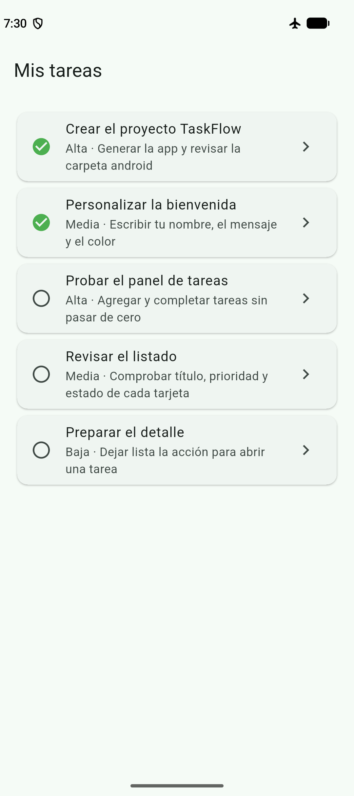

### Detalle con el usuario de la tarea

El detalle muestra prioridad, estado y `Usuario: 1`, que viene del campo `userId` del modelo `Task`.

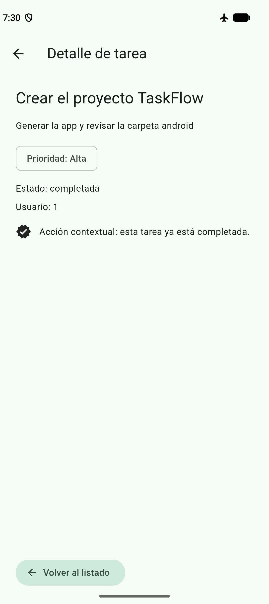


## Sesión 6 · Arquitectura MVVM con Provider

TaskFlow se reorganizó por funcionalidades. La lista y el detalle ya no leen una lista global: comparten un único `TasksViewModel` que entrega `ChangeNotifierProvider`, y el ViewModel pide los datos a un `TaskRepository`.

```
lib/
  main.dart
  app/taskflow_app.dart
  core/app_theme.dart
  features/tasks/
    domain/task.dart
    data/task_repository.dart
    data/local_task_repository.dart
    presentation/tasks_view_model.dart
    presentation/task_list_screen.dart
    presentation/task_detail_screen.dart
```

- **Model:** `Task` (`domain/task.dart`) conserva sus seis campos y `fromJson`, y añade `copyWith(isCompleted:)`.
- **Repository:** `TaskRepository` es el contrato (`getTasks`, `save`). `LocalTaskRepository` lo implementa en memoria con las cinco tareas propias de la sesión 5 (ids 1 a 5).
- **ViewModel:** `TasksViewModel` (`ChangeNotifier`) expone `tasks`, `findTask(id)` y `toggleCompleted(id)`, que guarda en el repositorio y llama a `notifyListeners()`.
- **View:** `TaskListScreen` y `TaskDetailScreen` leen el ViewModel con `context.watch`. El botón del detalle usa `context.read` para llamar a `toggleCompleted`.
- **Provider:** `main.dart` crea el repositorio, lo inyecta al ViewModel y envuelve `TaskFlowApp` con `ChangeNotifierProvider`.
- `core/app_theme.dart` conserva la paleta propia (semilla `#1F6F5B`) y `app/taskflow_app.dart` las rutas `/` y `/task/:id`.

Recorrido del dato: `onPressed` → `toggleCompleted` → `save` → `notifyListeners` → `build`. Los datos siguen en memoria: al reiniciar la app vuelven a su valor inicial. Todavía no hay solicitudes de red ni API.

Dependencia nueva: `provider`, agregada con `flutter pub add provider`.

Comprobaciones: `dart format lib`, `flutter analyze` sin errores y `flutter test` con 7 pruebas (modelo, `copyWith`, repositorio, ViewModel, cambio de estado entre detalle y lista, navegación e id inexistente).

## Evidencias de la sesión 6

Capturas del emulador Android (Pixel 10, API 37, `emulator-5554`) tomadas el 19 de noviembre de 2026 con `adb exec-out screencap`, con la app en ejecución.

### Lista inicial con cinco tareas propias

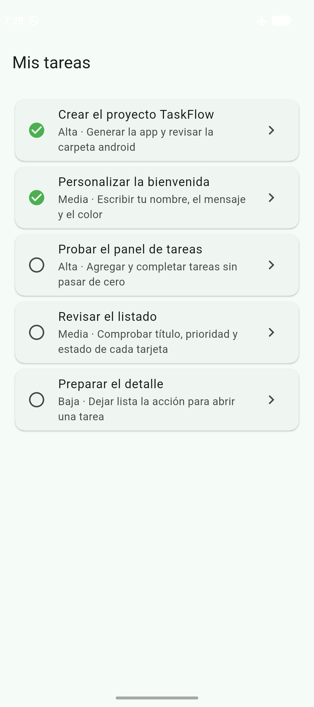

### Detalle antes de cambiar el estado

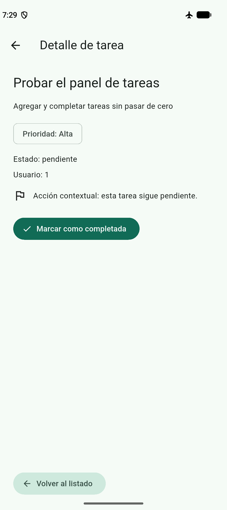

### Detalle después de cambiar el estado

El texto pasa a `Estado: completada`, cambian el icono de la acción contextual y el botón (`Marcar como pendiente`).

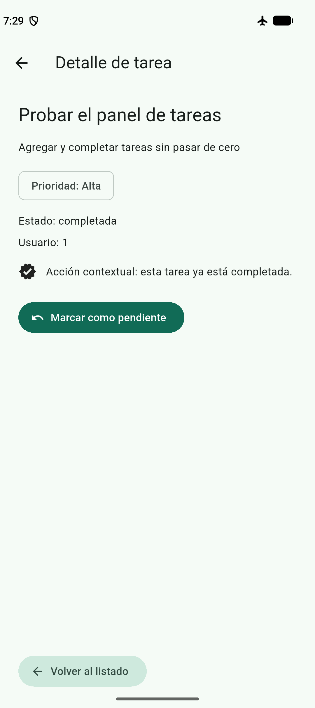

### Lista actualizada

Al volver, la tarjeta de la tarea muestra el icono de completada: lista y detalle comparten el mismo ViewModel.

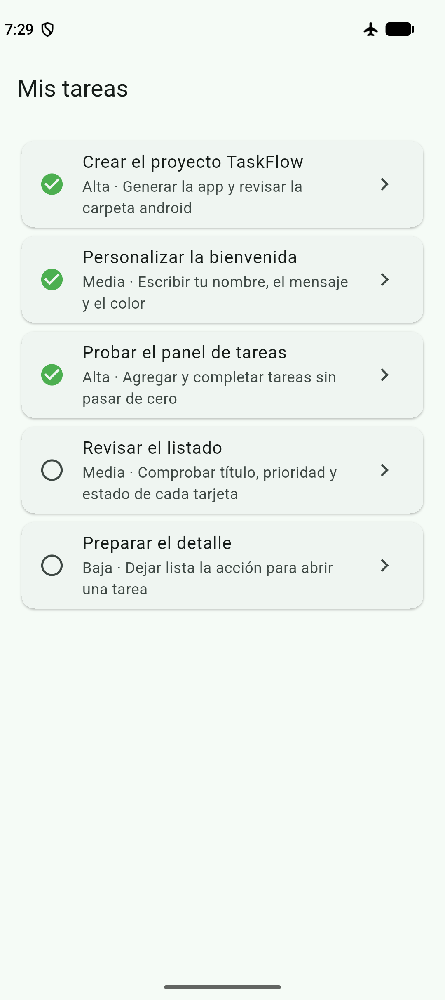

## Sesión 7 · Consultar tareas desde API

TaskFlow ya no usa la lista local al iniciar: consulta una API REST por HTTPS con Dio. La arquitectura MVVM de la sesión 6 se conserva y solo cambia la fuente de datos en `main.dart`.

```
lib/features/tasks/
  data/task_api_service.dart        ← nuevo: conoce la URL y hace GET con Dio
  data/remote_task_repository.dart  ← nuevo: pide al Service y guarda copia en memoria
  data/task_repository.dart         ← contrato asíncrono: Future<List<Task>> getTasks()
  data/local_task_repository.dart   ← conserva las cinco tareas propias (respaldo)
  presentation/tasks_view_model.dart← loadTasks(), isLoading y errorMessage
```

Recorrido del dato: `main.dart` construye `RemoteTaskRepository(TaskApiService())` → `TasksViewModel.loadTasks()` → `getTasks()` del Repository → `TaskApiService.getTasks()` → Dio hace `GET` → `Task.fromJson()` crea cada tarea → `notifyListeners()` redibuja la lista → la ruta `/task/:id` abre el detalle.

### API de tareas

- **API:** JSONPlaceholder, API pública de datos de prueba.
- **URL exacta:** `https://jsonplaceholder.typicode.com/todos?userId=2`
- **URL base en Dio:** `https://jsonplaceholder.typicode.com`, con `connectTimeout` y `receiveTimeout` de 10 s.
- **Parámetro `userId`:** el codelab usa `1`; en el trabajo autónomo se cambió la constante `TaskApiService.userId` a **2**. La API devuelve 20 tareas de ese usuario (ids 21 a 40).
- **Campos que llegan:** `userId`, `id`, `title` y `completed` (`completed` se lee como `isCompleted`).
- **Valores que completa TaskFlow por defecto:** la API no envía `description` ni `priority`, así que `Task.fromJson` usa `Sin descripción (API)` y `Sin prioridad (API)`. No vienen del servidor.
- **Marcar una tarea sigue siendo local:** `toggleCompleted` cambia la copia en memoria del Repository. JSONPlaceholder no guarda cambios; al reiniciar la app la tarea vuelve a su valor remoto. El CRUD remoto llega en la sesión 10.
- **Permiso Android:** `android.permission.INTERNET` en `android/app/src/main/AndroidManifest.xml`.
- **Dependencia nueva:** `dio`, agregada con `flutter pub add dio`.

Si la red falla, la lista muestra `No se pudieron cargar las tareas.` y la consola registra el error. La sesión 8 agregará estados más completos y el botón Reintentar.

Comprobaciones: `dart format lib test`, `flutter analyze` sin problemas y `flutter test` con 10 pruebas (JSON local y de JSONPlaceholder, `copyWith`, repositorio local asíncrono, carga del ViewModel, error de carga, lista con error, cambio de estado, navegación e id inexistente). Las pruebas no llaman a internet.

## Evidencias de la sesión 7

Capturas del emulador Android (Pixel 10, `emulator-5554`) tomadas el 21 de noviembre de 2026 con `adb shell screencap`, con la app en ejecución (`flutter run`).

### Listado remoto del usuario 2

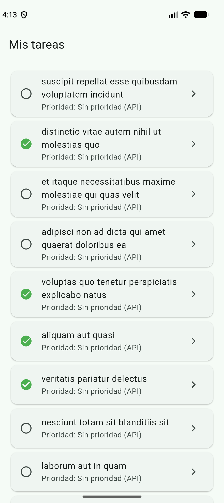

### Detalle de una tarea remota

Muestra los valores por defecto de descripción y prioridad, y `Usuario: 2`.


### Error sin conexión

En el primer arranque el emulador estaba en modo avión: la consulta falló y la lista mostró el mensaje de error.


### Consola

Salida real de `flutter run` y `flutter analyze`: [sesion-07-consola.txt](docs/evidencias/sesion-07-consola.txt)

```
I/flutter (15268): GET /todos?userId=2 → HTTP 200
```

## Sesión 8 · Estados de carga, lista, vacío y error

La lista remota ahora distingue cuatro situaciones y permite repetir la consulta sin reiniciar TaskFlow. Solo cambiaron el ViewModel y la lista: el modelo, el Service, el Repository, las rutas y el detalle siguen igual. Ningún widget hace solicitudes HTTP: la vista lee el estado con `context.watch` y llama a `loadTasks()` con `context.read`.

| Estado | Cuándo ocurre | Qué muestra TaskFlow | Acción |
|---|---|---|---|
| Carga | `isLoading` es verdadero mientras espera la red | Indicador y `Cargando tus tareas…`; el botón de la barra se desactiva | Ninguna (no se repite la solicitud) |
| Lista | La API respondió con tareas | Contador de tareas y una tarjeta por `Task` | Tocar una tarjeta, botón Actualizar de la barra o deslizar hacia abajo |
| Vacío | La API respondió bien con `[]` | Icono de bandeja y `Todavía no hay tareas para mostrar.` | **Actualizar** |
| Error | Falló la red, el servidor o el formato | Icono de nube tachada, `No se pudieron cargar las tareas.` y una pista | **Reintentar** |

- `TasksViewModel.isEmpty` es verdadero solo si no hay carga, no hay error y la lista está vacía: **vacío no es error**.
- `loadTasks()` sale de inmediato si ya hay una carga en curso (`if (isLoading) return;`), limpia `errorMessage` antes de cada intento y, si falla, deja la lista vacía y el detalle técnico en la consola.
- `TaskStateMessage` es un widget reutilizable para los estados de error y vacío (icono, título, explicación y botón).
- Actualizar vuelve a leer el servidor; por eso una marca local de completada se pierde, como en la sesión 7.

Comprobaciones: `dart format lib test`, `flutter analyze` sin problemas y `flutter test` con 15 pruebas. Las nuevas usan repositorios falsos sin internet: vacío frente a error, Reintentar recupera la lista, no se repite una carga en curso, la lista vacía ofrece Actualizar y no Reintentar, y Reintentar en pantalla recupera las tareas.

### Cómo se provocó cada estado

Emulador Android Pixel 10 (`emulator-5554`), 21 de noviembre de 2026, capturas con `adb shell screencap`:

1. **Lista:** `userId = 2` con internet. La consola muestra `GET /todos?userId=2 → HTTP 200` y aparecen 20 tareas.
2. **Carga:** se limitó la red del emulador (`adb emu network speed gsm` y `adb emu network delay gprs`) y se tocó Actualizar. No se agregó ninguna espera artificial al código. Después se restauró la red (`speed full`, `delay none`).
3. **Error:** se activó el modo avión del emulador (`adb shell cmd connectivity airplane-mode enable`) y se tocó Actualizar. La consola registra `Failed host lookup`.
4. **Reintentar:** se desactivó el modo avión y se tocó **Reintentar** en la misma ejecución, sin reiniciar la app: volvió la lista con `HTTP 200`.
5. **Vacío:** se cambió temporalmente `TaskApiService.userId` a `9999` y se reinició la app. La API respondió `HTTP 200` con una lista vacía. Después se restauró `userId = 2`, que es el valor que queda en el código.

## Evidencias de la sesión 8

### Lista con tareas remotas


### Carga con red limitada


### Error sin conexión


### Reintentar recupera la lista sin reiniciar


### Respuesta vacía (userId 9999)

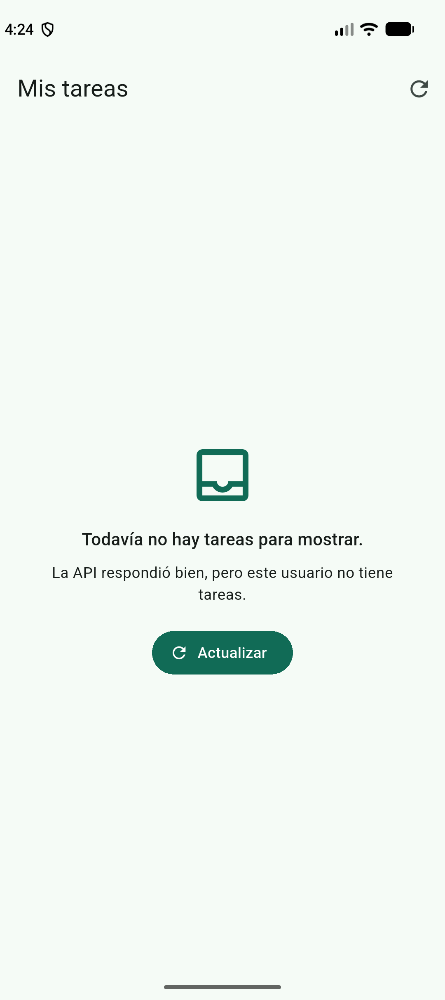

Salida real de consola: [sesion-08-consola.txt](docs/evidencias/sesion-08-consola.txt)

## Sesión 9 · Formulario de tareas

TaskFlow tiene la pantalla **Nueva tarea** en la ruta `/new`. Se abre con el botón flotante de la lista, valida los datos antes de guardar y devuelve un borrador (`TaskDraft`) a la lista con `context.pop(draft)`. **Todavía no se envía nada a la API:** el mensaje de retorno lo aclara y la sesión 10 conectará Guardar con `POST`.

```
lib/features/tasks/presentation/
  task_form_screen.dart   ← nuevo: TaskDraft, TaskFormValidators y TaskFormScreen
  task_list_screen.dart   ← botón flotante "Nueva tarea" y SnackBar de retorno
lib/app/taskflow_app.dart ← nueva ruta /new (se conservan / y /task/:id)
```

- **Form + GlobalKey<FormState>:** `validate()` revisa todos los campos juntos al tocar Guardar.
- **TextEditingController:** lee título y descripción; se liberan en `dispose()`.
- **Validaciones propias (`TaskFormValidators`):**
  - Título obligatorio: `Ponle un nombre a tu tarea.`; menos de 3 caracteres: `El título es muy corto: usa al menos 3 caracteres.`; más de 60: `Resume el título en 60 caracteres o menos.`
  - Descripción opcional, hasta 200 caracteres.
  - Prioridad obligatoria (Alta, Media o Baja): `Elige una prioridad: Alta, Media o Baja.`
- **Fecha límite opcional** con `showDatePicker`: se puede guardar sin elegirla y se puede quitar con la ✕. Se muestra como dd/mm/aaaa sin paquetes extra.
- Después del primer intento fallido el formulario se revalida mientras se escribe, así el error desaparece al corregirlo.
- **Guardar** con datos válidos vuelve a la lista y muestra: `Tarea lista: <título> · <prioridad> · para el dd/mm/aaaa. Se enviará a la API en la sesión 10.`
- **Cancelar** (o la flecha atrás) vuelve sin mensaje. El detalle de cada tarea sigue abriendo.

Comprobaciones: `dart format lib test`, `flutter analyze` sin problemas y `flutter test` con 19 pruebas. Las nuevas cubren las reglas de validación, el formulario con errores que no regresa, el formulario válido que vuelve con mensaje y Cancelar sin mensaje.

Nota: el selector de fecha aparece en inglés porque la app aún no carga traducciones de Material (`flutter_localizations`); se puede agregar más adelante.

## Evidencias de la sesión 9

Emulador Android Pixel 10 (`emulator-5554`), 21 de noviembre de 2026, capturas con `adb shell screencap` y la app en ejecución.

### Errores de validación (Guardar con el formulario vacío)

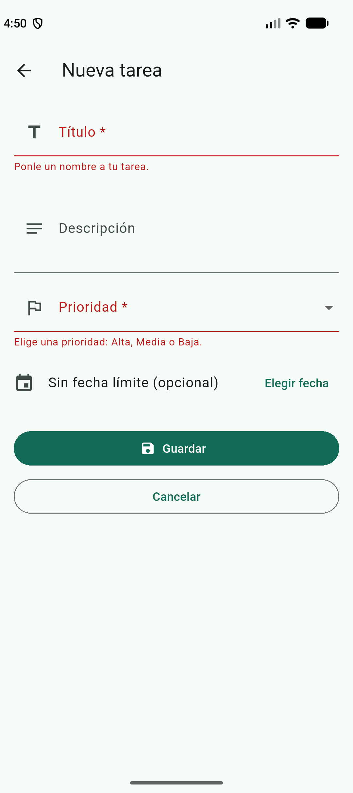

### Título demasiado corto

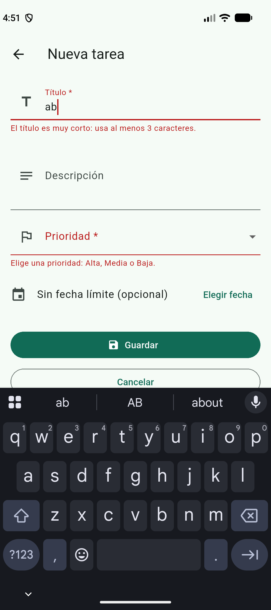

### Formulario válido con fecha opcional

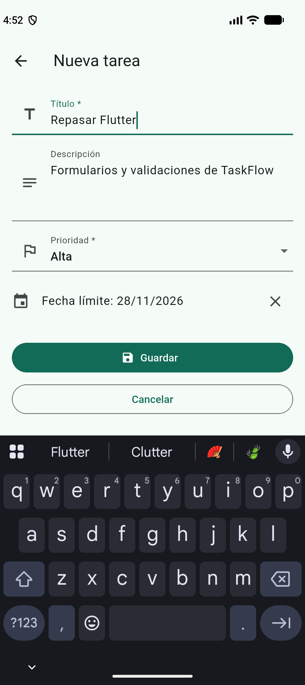

### Mensaje al volver a la lista

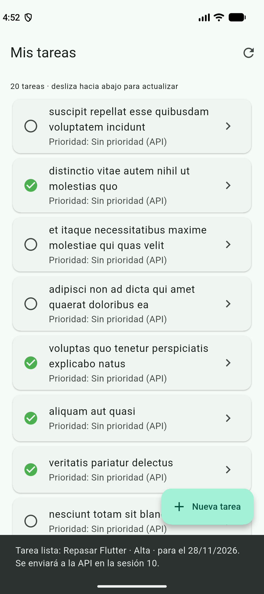

### Botón Nueva tarea y Cancelar sin mensaje


## Sesión 10 · CRUD de tareas con la API

TaskFlow ya crea, consulta, edita, marca y elimina tareas contra JSONPlaceholder. El flujo sigue siendo **Pantalla → ViewModel → Repository → ApiService → Dio**: las pantallas no llaman a Dio.

```
lib/features/tasks/
  domain/task.dart                  ← copyWith(title, isCompleted) y toJson()
  data/task_api_service.dart        ← createTask (POST), updateTask (PATCH), deleteTask (DELETE)
  data/task_repository.dart         ← contrato con createTask, updateTask y deleteTask
  data/remote_task_repository.dart  ← usa la API y mantiene la lista en memoria
  data/local_task_repository.dart   ← misma interfaz para pruebas sin red
  presentation/tasks_view_model.dart ← createTask, updateTask y deleteTask
  presentation/task_list_screen.dart ← Guardar del formulario hace POST
  presentation/task_detail_screen.dart ← Editar título, Marcar (PATCH) y Eliminar con confirmación
```

| Operación | Método y endpoint | Dónde se usa |
|---|---|---|
| Consultar | `GET /todos?userId=2` | Lista al abrir y al deslizar |
| Crear | `POST /todos` | Guardar en **Nueva tarea** |
| Editar / marcar | `PATCH /todos/{id}` | **Editar título** y **Marcar como completada/pendiente** |
| Eliminar | `DELETE /todos/{id}` | **Eliminar** (ícono o botón) tras confirmar |

- La lista solo cambia **después** de una respuesta correcta: si la petición falla no se muestra éxito y aparece `No se pudo crear la tarea`, `No se pudo actualizar` o `No se pudo eliminar la tarea`.
- **Eliminar** abre un `AlertDialog` (Cancelar / Eliminar); al confirmar vuelve a la lista con `Tarea eliminada: <título>`.
- **Editar título** usa la misma regla del formulario (mínimo 3 caracteres).

**Importante: JSONPlaceholder simula las escrituras.** Responde `201` al crear y `200` al editar o eliminar, pero no guarda nada: al reiniciar la app o deslizar para actualizar vuelven los datos originales. El `POST` siempre devuelve el id `201`; si ese id ya estuviera en la lista, el Repository usa el siguiente libre para que cada ruta `/task/:id` sea única.

Comprobaciones: `dart format lib test`, `flutter analyze` sin problemas y `flutter test` con 27 pruebas (Repository local, `copyWith`/`toJson`, ViewModel con éxito y con error, crear desde el formulario, editar título, eliminar con confirmación y error al eliminar sin mensaje de éxito).

## Evidencias de la sesión 10

Emulador Android Pixel 10 (`emulator-5554`), 24 de noviembre de 2026, capturas con `adb shell screencap` y la app en ejecución contra JSONPlaceholder. Consola: [`docs/evidencias/sesion-10-consola.txt`](docs/evidencias/sesion-10-consola.txt).

### Antes de crear (20 tareas del usuario 2)

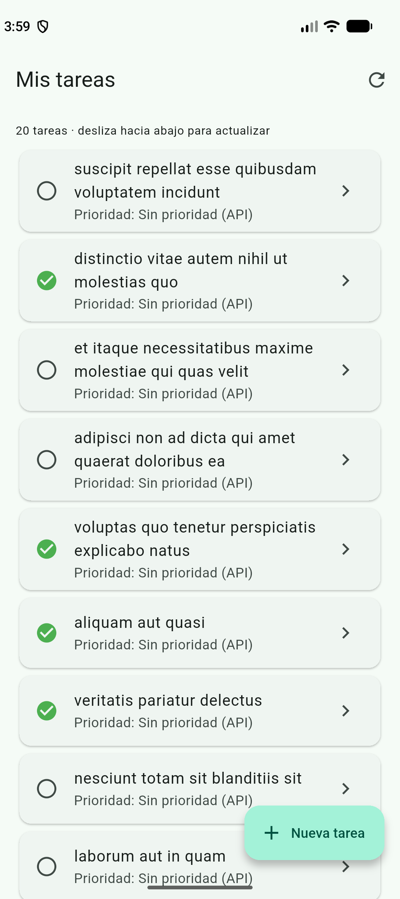

### Crear: formulario y resultado del POST

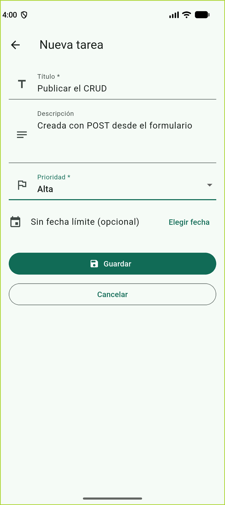

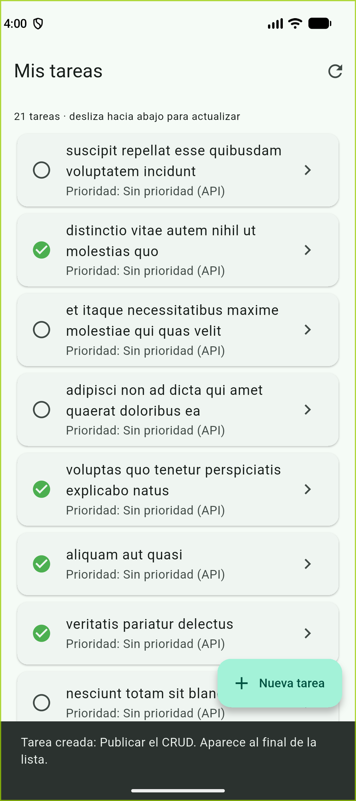

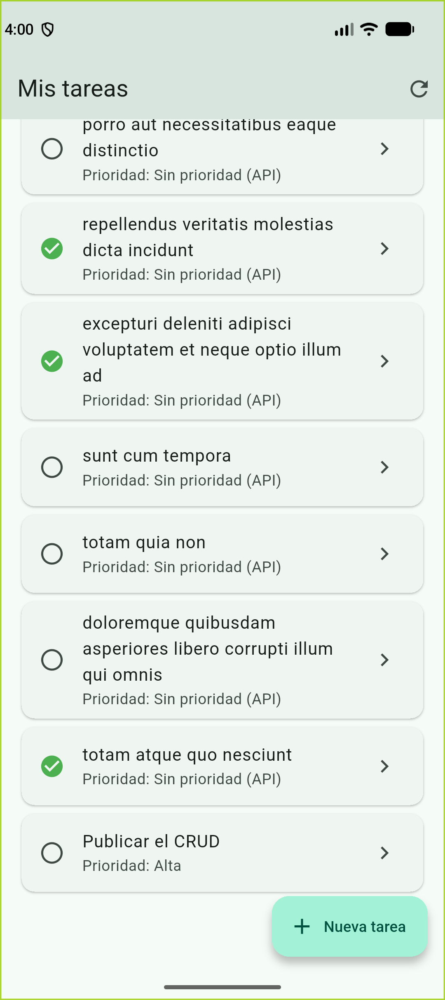

### Editar: antes, diálogo y después del PATCH

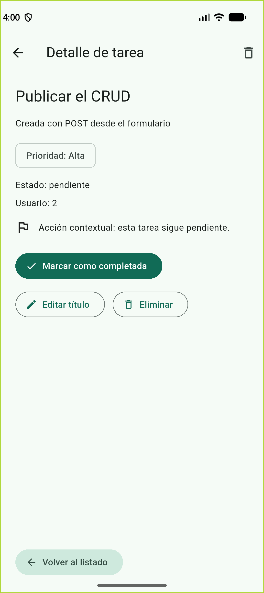

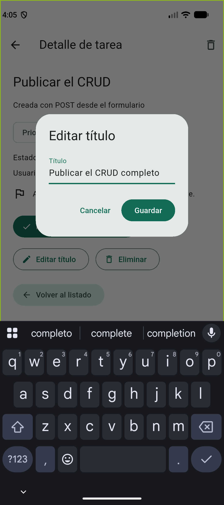

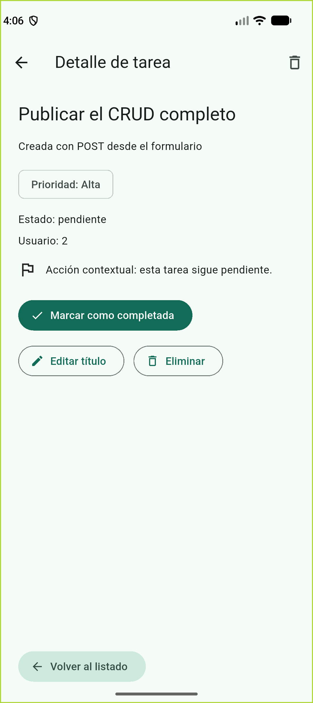

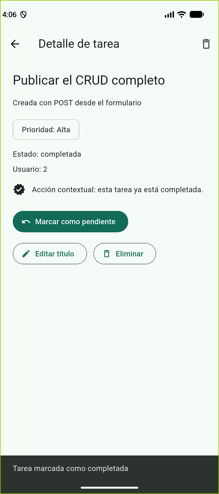

### Eliminar: confirmación y lista sin la tarea

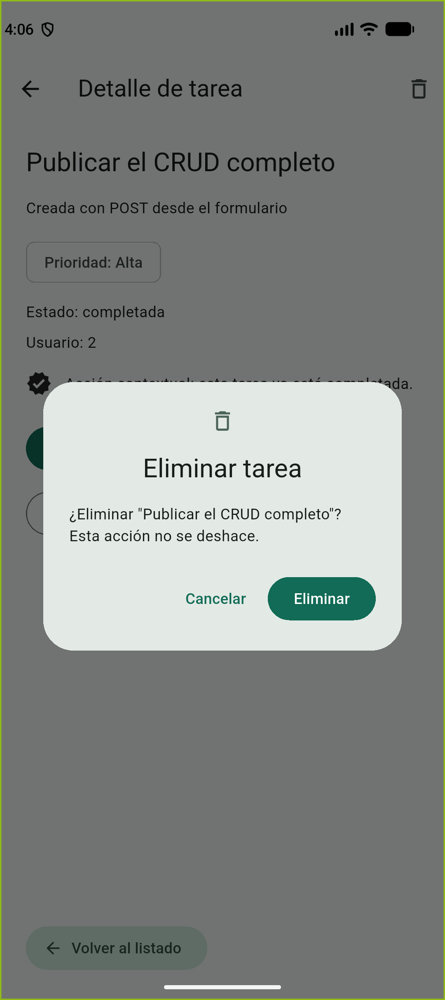

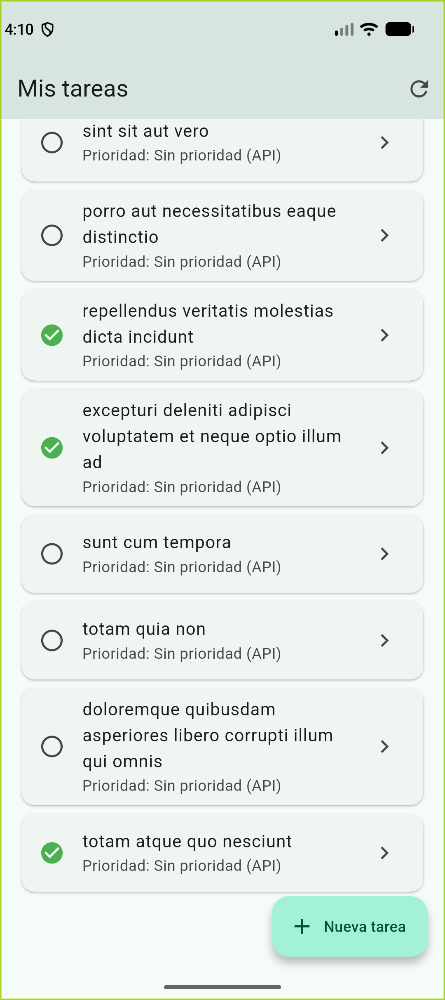

### Consola

```
POST /todos → HTTP 201
PATCH /todos/201 → HTTP 200   (editar título)
PATCH /todos/201 → HTTP 200   (marcar como completada)
DELETE /todos/201 → HTTP 200
```

## Sesión 11 · Manejo de errores y recuperación

TaskFlow explica qué falló y deja recuperarse sin reiniciar la app. Los errores técnicos de Dio se traducen en el **Repository** a una excepción propia, `TaskFailure` (`lib/core/task_failure.dart`); la vista solo muestra su mensaje y el detalle técnico queda en la consola.

```
lib/core/task_failure.dart              ← nuevo: TaskFailure y TaskFailureKind
lib/features/tasks/data/remote_task_repository.dart ← traduce DioException y FormatException
lib/features/tasks/presentation/tasks_view_model.dart ← on TaskFailure, isSaving, saveErrorText
lib/features/tasks/presentation/task_list_screen.dart ← icono y título según el tipo de error
lib/features/tasks/presentation/task_form_screen.dart ← el formulario hace el POST y deshabilita Guardar
lib/features/tasks/presentation/task_detail_screen.dart ← acciones deshabilitadas mientras se envía
```

| Situación | Tipo | Mensaje en pantalla |
|---|---|---|
| Sin internet (modo avión) | `network` | **Sin conexión** · Revisa tu conexión a internet. |
| Espera mayor a 10 s (`connectTimeout`, `sendTimeout`, `receiveTimeout`) | `timeout` | **El servidor no respondió a tiempo** · El servidor tardó demasiado. Inténtalo de nuevo en unos segundos. |
| Respuesta 4xx / 5xx | `server` | **La API respondió con error** · La API respondió con HTTP 404: no se encontró la ruta solicitada. (5xx: el servidor tuvo un problema; otro 4xx: la solicitud no es válida) |
| JSON con otra forma | `data` | La API devolvió datos inesperados. |
| Cualquier otro error | `unexpected` | Ocurrió un problema inesperado. |

- **Reintentar** vuelve a llamar a `loadTasks()`; con la red restaurada la lista aparece sin reiniciar.
- **Guardar deshabilitado mientras se envía:** el ViewModel tiene `isSaving`. Mientras es `true` el botón muestra *Guardando…*, los campos y Cancelar se bloquean y un segundo toque no envía otro POST (el método devuelve `false`). `isSaving` vuelve a `false` en `finally`, así ninguna pantalla queda en espera permanente.
- Si el POST falla, **el formulario sigue abierto con los datos** y muestra `No se pudo crear la tarea. <motivo>`; al volver la red basta tocar Guardar otra vez. En el detalle, Marcar, Editar título y Eliminar también se deshabilitan durante la solicitud y muestran el motivo si fallan.
- No se reintenta un POST automáticamente: repetirlo podría duplicar la tarea.

Comprobaciones: `dart format lib test`, `flutter analyze` sin problemas y `flutter test` con 37 pruebas (traducción de cada `DioException`, Repository que nunca entrega `DioException`, ViewModel con `TaskFailure` y error desconocido, doble envío ignorado, Guardar deshabilitado, formulario abierto tras un fallo y Reintentar después de cada tipo de error).

## Evidencias de la sesión 11

Emulador Android Pixel 10 (`emulator-5554`), 24 de noviembre de 2026, capturas con `adb shell screencap`. Fallos provocados de verdad: modo avión (`adb shell cmd connectivity airplane-mode enable`), ruta temporal `/ruta-inexistente` en el Service (restaurada antes del commit) y latencia de 15 s con `adb emu network delay 15000:15000`. Consola: [`docs/evidencias/sesion-11-consola.txt`](docs/evidencias/sesion-11-consola.txt).

### Error 1: sin conexión

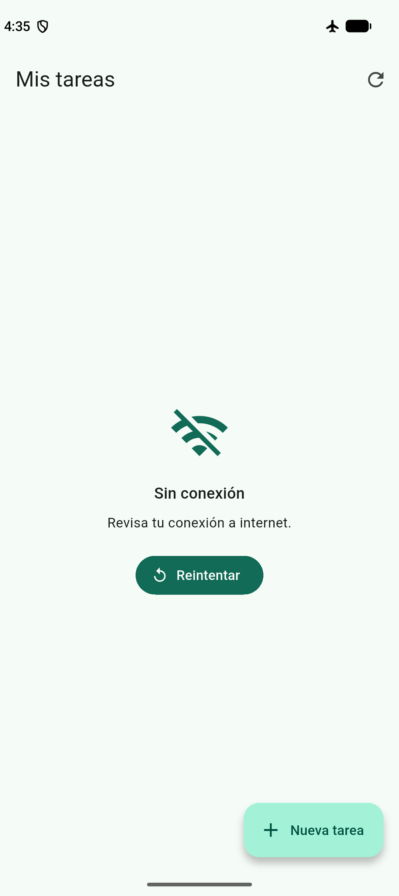

### Recuperación con Reintentar


### Error 2: la API responde HTTP 404

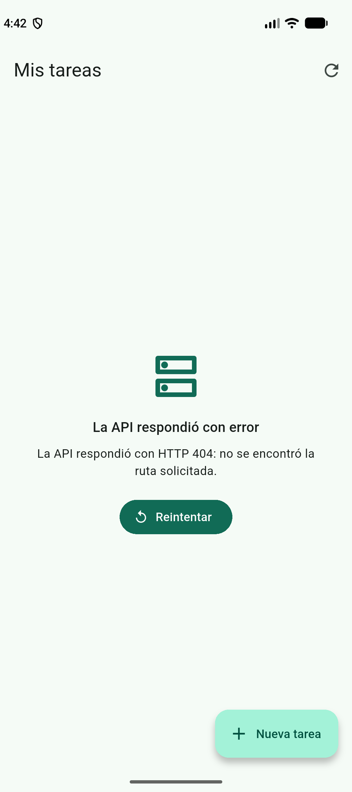

### Error 3: tiempo de espera agotado y recuperación

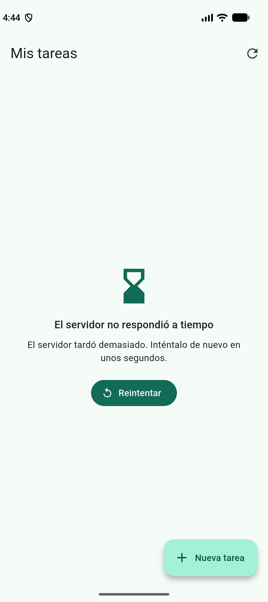

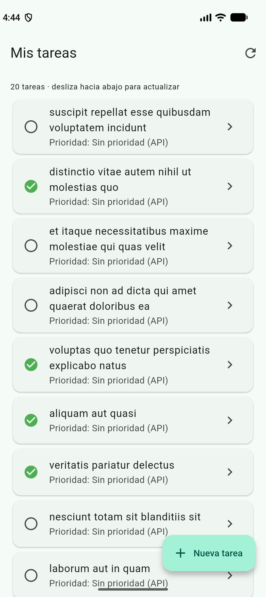

### Guardar deshabilitado mientras se envía

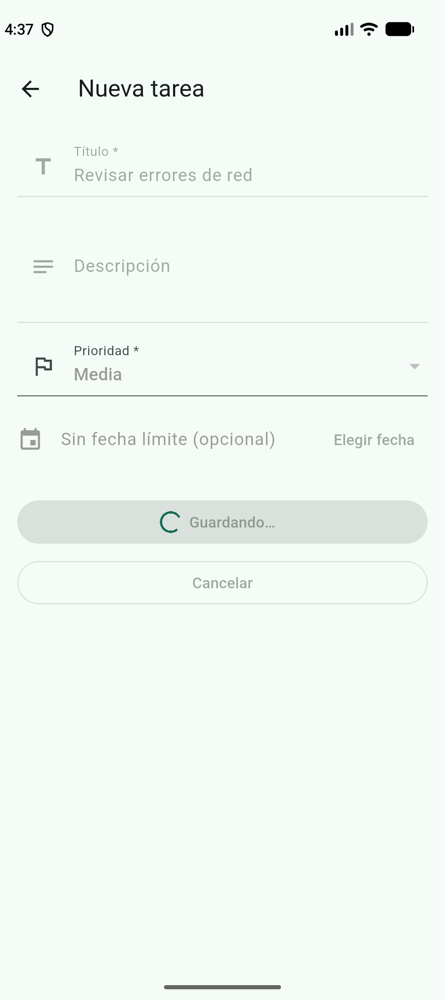

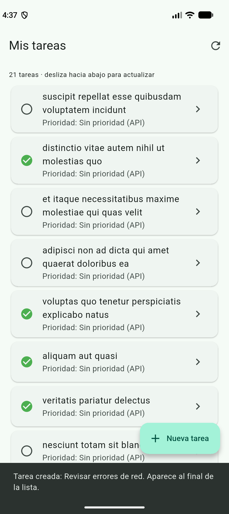

### Guardar sin internet y reintentar

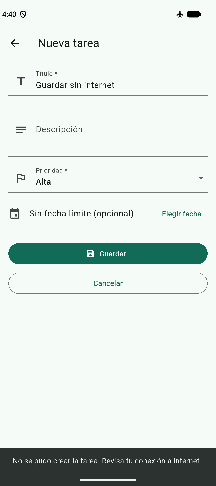

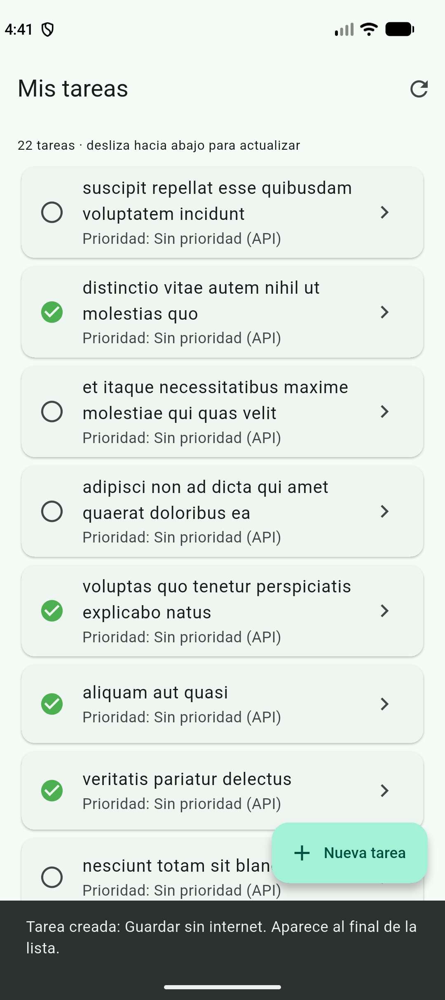
